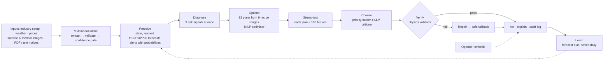

# ⚡ Renewable Energy Orchestrator

**Team Vaishnav2728Hritika · ET AI Hackathon: Agentic Edition · Claimed position: D3 × F3**

An autonomous AI control room for an industrial renewable energy portfolio. Every 15 minutes, and immediately after any shock, it decides how to run solar farms, wind farms, batteries, flexible factory loads and the grid connection to **cut cost, maximise clean energy and protect critical load**. It reads **satellite images, thermal inspection images and written notices** alongside live data, tests every candidate plan against **100 possible futures**, acts within limits set by management, and explains every decision in plain English.

| Over 100 randomized days with unannounced storms, breakdowns and price spikes | AI vs business-as-usual |
|---|---|
| Energy cost | **−23%** (cheaper on 100 of 100 days) |
| CO₂ | **−42%** |
| Critical load cut | **−56%** |
| Safety violations | **0** (business-as-usual: 4.9 per day) |
| Wrong findings acted on from images & documents | **0** of 256 applied, from 350 labelled cases |

📄 **Solution deck:** [`deck/Solution_Deck.pdf`](deck/Solution_Deck.pdf)

---

## For judges: see it in 5 minutes

```bash
git clone https://github.com/Akshadman/renewable-energy-orchestrator.git
cd renewable-energy-orchestrator
python3 -m venv .venv && source .venv/bin/activate
pip install -r requirements.txt
streamlit run app.py          # opens the dashboard; works with no API key and no internet
```

Then, in the dashboard:

1. **⚡ Live control room → ▶ Play.** The AI runs the day on live weather for real farm locations in Rajasthan, Gujarat and Tamil Nadu.
2. **📥 Evidence from images & documents:** satellite scenes, thermal images and notices it has already read, with what it applied and what it **quarantined** and why.
3. **🎛️ Make something happen → Storm forecast.** Inject a storm at 10%, then 90%, and compare the plans in **🧠 What the AI is thinking**: the battery reserve rises with the probability.
4. **Feed a new image or document** (any file from `data/multimodal_samples/`) and watch it re-plan instantly.
5. **Sidebar → 🛑 Operator override:** a human takes control instantly.
6. **📊 Results & learning:** the best plan recipe of the day and why it won, savings vs business-as-usual, what the AI learned, and the 100-day proof.

Verify the claims yourself:

```bash
python -m eval.multimodal_eval      # D3 reliability on 350 labelled images & documents (~1 min)
pytest                              # 89 automated tests (~10 min; several simulate full days)
python -m eval.evaluate --n 100     # 100-day comparison vs business-as-usual (~30–60 min)
```

---

## Our grid position: D3 × F3

| Axis | Requirement | Evidence |
|---|---|---|
| **D3** | Highly heterogeneous multimodal input | NASA MODIS satellite images · thermal / drone panel images · PDF work orders and grid-operator notices · free-text fault reports and emails · weather API (JSON) · price and consumption CSV · asset tables |
| **D3** | High degree of demonstrable reliability | 0 wrong of 256 applied findings, from 350 labelled images and documents · 40 / 40 vague notices quarantined · 0 safety violations in 100 days · validator, repair and safe fallback on every decision |
| **F3** | Simulate the situation over time, accounting for variations in inputs | Every plan is replayed in 100 sampled futures (forecast spread + alert probabilities) · 24-hour day-ahead plan · full-day digital twin with 11 shock types · 100-day Monte Carlo |

F1 (optimal set of actions) and F2 (situation-specific criteria under uncertainty) are covered along the way; see the deck.

**What we deliberately do not claim**
- No audio / voice input.
- Thermal test images are **synthetic with known ground truth**, because no real drone data was available. Satellite scenes, weather data and document formats are real. A real drone image without temperature-calibration metadata is analysed but **held for operator review** until calibrated with the camera's temperature range, by design.
- Plant meters come from a physics-based **digital twin**; the same interface accepts live SCADA data.
- The price file `data/iex_prices.csv` is a **labelled sample** in IEX 15-minute format.

---

## Where each judging criterion is evidenced

| Criterion | Where to look |
|---|---|
| **Significance & relevance** | Indian industrial renewable portfolios re-planned every 15 min; default site = 5 solar, 3 wind, 2 batteries, 4 industrial loads |
| **Innovation & originality** | Plan recipes as **parameter ranges** searched every tick; risk handled as **probabilities** across 100 futures, not fixed "situations"; multimodal evidence gated by confidence |
| **Effective use of AI** | Computer vision (cloud masks, hot-spot detection), document understanding, MILP optimisation, Monte Carlo simulation, online learning, and an LLM agent that can **propose and test its own plan** |
| **Technical complexity** | `agent/`, `core/` · 89 tests · reproducible evaluations in `eval/` |
| **Agentic / autonomous capability** | Perceives → diagnoses → plans → simulates → chooses → verifies → acts → explains → learns; sends repair crews and reschedules maintenance itself; recovers from solver, data and LLM failures |
| **Business impact** | −23% cost, −42% CO₂, −56% critical load cut over 100 days; live "money saved" vs a business-as-usual twin |
| **Prototype quality** | Streamlit control room with 3 tabs; runs offline with no key |
| **Scalability, responsible AI, robustness** | Any industry via configuration · LLM never outputs megawatts · physics validator · confidence gate · operator override · full audit log |

---

## How the AI decides



1. **Perceive:** plant state, forecasts already corrected by what the AI has learned, prices, and alerts that carry a probability (e.g. "storm 35% likely in 90 min").
2. **Diagnose:** nine signals measured **together**: storm probability, price vs normal, grid-line headroom, batteries in service, generation offline, demand surprise, renewable shortfall, battery charge and CO₂ budget pace. Nothing is reduced to a single "situation".
3. **Options:** nine plan recipes (Max savings, Lean, Balanced, Green-lean, Steady, Cautious, Protective, Strong reserve, Fortress). Each is a **range** for battery reserve, price/clean/reliability weights and forecast caution. The AI tries 3 combinations inside every range, then 6 more around the best (**33 plans**). The optimiser turns each into exact megawatt set-points for the next 4 hours.
4. **Stress-test:** each plan is replayed in **100 sampled futures**. A 35% storm hits in about 35 of them. Output: average cost, worst-case cost, probability of cutting critical load, CO₂, battery wear.
5. **Choose with a priority ladder:**
   1. physically safe
   2. risk of cutting critical load ≤ the industry's tolerance (default 2%)
   3. best cost-vs-clean score, weighted by the carbon target and worst-case aversion
   4. least battery wear

   An LLM, if configured, may challenge the pick by **proposing its own plan**, which is tested exactly like the others, and then chooses among the eligible plans with a written rationale.
6. **Verify → act → explain:** validated again; if nothing passes, constraints are relaxed, and as a last resort a safe rule-based controller acts. Every decision is logged with all 33 plans and their scores.
7. **Learn:** every 1-hour-ahead forecast is compared with what happened, and bias and uncertainty bands are corrected and saved for the next day.

**Protection scales with probability** (same day, storm forecast at 18:00):

| Storm probability | 0% | 10% | 50% | 90% |
|---|---|---|---|---|
| Battery reserve the AI keeps | 27% | 43% | 52% | 60% |

---

## Multimodal intake (D3)

| Modality | How it is understood | What it changes |
|---|---|---|
| 🛰️ **Satellite** (`core/multimodal/satellite.py`) | Real NASA MODIS scene around each solar farm → cloud mask → compared with the forecast at the ~10:30 overpass | A gap of ≥25 points derates or uplifts that farm's solar |
| 🌡️ **Thermal / drone images** (`thermal.py`) | Per-module median → noise filter → robust threshold → hot-spot modules | Farm capacity derated; repair job scheduled by the AI |
| 📄 **PDF / text notices** (`documents.py`) | Classify → extract asset, time window and size (rule parser, or the configured LLM) → validate | Maintenance request, outage, grid-line limit or demand change |
| **Gate** (`intake.py`) | Confidence ≥75% → applied to the plant and the AI re-plans; otherwise **quarantined** for a human | Corrupt or unsupported files are rejected without stopping control |

**Reliability on labelled data** (`python -m eval.multimodal_eval`):

| Test | Result |
|---|---|
| Thermal images, easy / medium (50 + 50) | 100% exact defect count · 96 applied · **0 wrong** |
| Thermal images, hard: heavy noise + glare (50) | All held back (detection unreliable) · **0 applied** |
| Documents: 160 clear + 40 vague notices, many formats | 160 / 160 applied correctly · 40 / 40 quarantined · **0 wrong** |
| Satellite cloud detector | 0.33-point mean error on 60 synthetic clouds over 9 real NASA scenes of our sites (a favourable test for a whiteness detector) |

---

## Results: 100-day Monte Carlo

100 randomized days, 3 unannounced shocks per day (storms with random probabilities, breakdowns, price spikes, congestion, …). All controllers see identical weather, demand, prices and shocks. Results are from offline mode (optimiser + ladder, no LLM).

| Mean per day | **AI** | Business-as-usual | No battery |
|---|---:|---:|---:|
| Cost (₹ lakh) | **72.4** (−23%) | 94.2 | 101.2 |
| Clean energy | **72.4%** | 61.6% | 57.4% |
| Curtailment (MWh) | **9.8** | 22.3 | 44.0 |
| Critical load cut (MWh) | **5.3** (−56%) | 12.1 | 13.5 |
| All load cut incl. flexible (MWh) | **5.4** (−82%) | 30.1 | 32.8 |
| Safety violations | **0.00** | 4.87 | 3.60 |
| CO₂ (t) | **557** (−42%) | 957 | 1062 |

- We lead with **critical** load (−56%) rather than total load (−82%): almost all of the AI's remaining cuts are physical shortages no plan can cover (e.g. a storm while the grid line is congested), where it protects critical load first and says so.
- The AI cut some critical load on 8 of 100 days, vs 20 for business-as-usual.
- **Safety violations** = executed commands that broke a physical limit (battery charge, power rating, line limit, unavailable asset).

---

## Responsible AI and human oversight

- **No hallucinated actions:** the LLM can only propose plan *settings* or pick a validated plan id; all megawatts come from the optimiser, and ineligible picks are rejected in code.
- **Physics guardrails:** every action is validated before execution; the digital twin independently counts violations.
- **Confidence gate:** image and document findings below 75% confidence are quarantined for a human.
- **Human oversight:** an **operator override** hands control to a safe controller instantly; high-impact actions (load shedding, large exports, moved maintenance) are flagged for review; management sets risk tolerance, targets and recipe ranges.
- **Audit:** every decision is logged to `logs/decisions.jsonl` (signals, evidence, all 33 plans, stress results, choice, action, explanation) and is reproducible with seeded scenarios.
- **Fault tolerance:** weather falls back live → same day last year → saved day → simulated; the solver repairs or falls back; LLM failures leave the optimiser in charge, shown as **LLM: FAILED** in the sidebar.
- **Privacy & security:** no personal data; API keys only in `.env`; a real plant would be connected read-only first, in shadow mode.

---

## Optional: enable an LLM (free options available)

Without a key, the optimiser and priority ladder decide on their own. To add an LLM, copy `.env.example` to `.env` and set **one** key: `GROQ_API_KEY` (free tier), `GEMINI_API_KEY` (free tier), `ANTHROPIC_API_KEY`, `OPENROUTER_API_KEY`, or `LLM_BASE_URL` for a local model (e.g. Ollama). The sidebar shows **LLM: ON / OFF / FAILED**.

---

## Repository map

| Path | What it does |
|---|---|
| `app.py` | Streamlit dashboard (setup · live control room · results & learning) |
| `agent/agent.py` | The autonomous loop, priority ladder, repair, operator override, operations |
| `agent/recipes.py` · `signals.py` · `stress_test.py` | Recipe ranges & search · risk signals · 100-future stress test |
| `agent/llm.py` · `prompts.py` · `tools.py` | Provider-neutral LLM client · prompt · `propose_plan` and `submit_decision` tools |
| `agent/runner.py` | AI twin + business-as-usual twin in lockstep, multimodal intake, outputs |
| `core/multimodal/` | Satellite, thermal, document understanding and the confidence gate |
| `core/optimizer.py` | Rolling-horizon MILP (PuLP / CBC) |
| `core/simulator.py` · `events.py` · `data_sources.py` | Digital twin, 11 shock types, weather and price sources |
| `core/learning.py` | Online forecast-bias and band-width learning |
| `eval/` | 100-day Monte Carlo, multimodal reliability evaluation, A/B design tests |
| `deck/` | Solution deck (PDF / HTML) and the script that builds it from the results |
| `tests/` | 89 automated tests |

Runs on Python 3.9+. Default site: `config/assets.yaml` (Rajasthan / Gujarat / Tamil Nadu portfolio).

---

## Limitations and roadmap

| Today | Next |
|---|---|
| Thermal test images are synthetic; no audio input | Real drone datasets; field-crew voice notes through the same document pipeline |
| Plant data from a digital twin | Live SCADA / meter / battery adapter with data-health monitoring |
| Sample IEX prices | Real IEX day-ahead and real-time prices with deviation penalties |
| Results measured without the LLM | A/B test of the LLM layer over 100 days with a free-tier model |
| 33-plan search finds very good plans, not a proven optimum | Full stochastic optimisation |
| Single-bus electrical model | Network constraints inside the plant |
